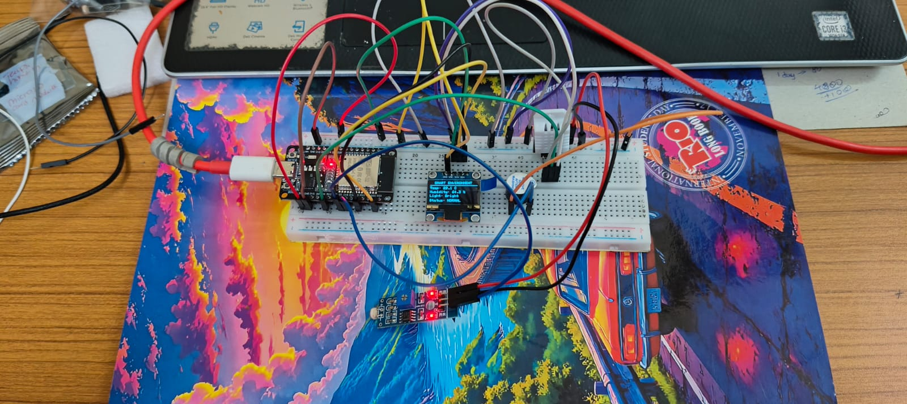

# Smart Environment Monitoring System Using ESP32

## Overview

The Smart Environment Monitoring System is an ESP32-based project that monitors temperature and humidity using a DHT22 sensor. The measured values are displayed on a 0.96-inch OLED display. A buzzer provides an alert when temperature or humidity exceeds a predefined threshold.

This project demonstrates sensor interfacing, real-time monitoring, display integration, and alert generation in an embedded system.

## Project Demonstration

Watch the ESP32-based Smart Environment Monitoring System in action on LinkedIn.

**Video Demonstration:** [Watch the Project on LinkedIn](https://lnkd.in/p/gB4Ni_Sh)

## Key Features

- Real-time temperature and humidity monitoring using the DHT22 sensor
- Live readings displayed on a 128 × 64 OLED screen
- Buzzer alert when temperature exceeds 30°C or humidity exceeds 70%
- ESP32-based sensor interfacing and threshold monitoring

## Features

- Real-time temperature monitoring
- Real-time relative humidity monitoring
- Live readings displayed on an OLED screen
- Buzzer alert when temperature exceeds 30°C
- Buzzer alert when humidity exceeds 70%
- Continuous monitoring using ESP32

## Components Used

- ESP32 development board
- DHT22 temperature and humidity sensor
- 0.96-inch OLED display (SSD1306, 128 × 64)
- Buzzer
- Breadboard
- Jumper wires
- USB cable for programming and power

## Pin Connections

| Component | ESP32 Pin |
|---|---|
| DHT22 Data | GPIO 4 |
| OLED SDA | GPIO 21 |
| OLED SCL | GPIO 22 |
| Buzzer | GPIO 18 |

The OLED display uses I²C communication.

## Working Principle

1. The DHT22 sensor measures the surrounding temperature and relative humidity.
2. The ESP32 reads the sensor measurements.
3. The OLED displays the current temperature and humidity values.
4. If temperature exceeds 30°C **or** relative humidity exceeds 70%, the buzzer activates and an alert is shown on the display.
5. The system continuously updates the readings and checks the threshold conditions.

## Alert Conditions

- **Temperature:** Greater than 30°C
- **Humidity:** Greater than 70% RH

The buzzer activates when either condition is exceeded.

## Project Photo

## Project Photo

## Source Code

[View Smart Environment Monitoring Arduino Code](./Smart_Environment_Monitor.ino)

## Libraries Used

- DHT sensor library
- Adafruit SSD1306
- Adafruit GFX Library

## Learning Outcomes

- Interfacing a DHT22 sensor with ESP32
- Reading temperature and humidity data
- Displaying sensor data using an I²C OLED
- Implementing threshold-based alerts
- Integrating sensors, displays, and output devices
- Understanding embedded-system monitoring applications

## Applications

- Indoor environmental monitoring
- Room temperature and humidity monitoring
- Basic laboratory monitoring
- Educational IoT and embedded-systems demonstrations

## Project Status

Completed as a hands-on embedded-systems project.

## Future Improvements

- Add Wi-Fi-based remote monitoring.
- Create a web dashboard for live readings.
- Log measurements for historical analysis.
- Add additional environmental sensors.

## Platform and Tools

- **Microcontroller:** ESP32
- **Programming Environment:** Arduino IDE
- **Programming Language:** Arduino C/C++
- **Application Area:** Embedded Systems and Environmental Monitoring
